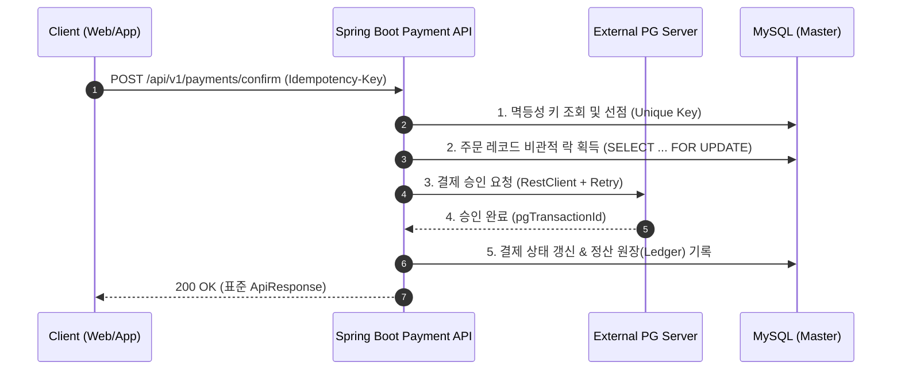

# Spring Boot 3 Commerce Order, Payment & Settlement API

> **고신뢰성 커머스 주문·결제 연동(멱등성 보장) 및 자동 정산 집계 백엔드 시스템**  
> Java 17 · Spring Boot 3.2 · Spring Data JPA · MySQL · OpenAPI 3.0 (Swagger)

---

## 1. 프로젝트 개요 (Overview)
커머스 플랫폼에서 가장 높은 데이터 정합성이 요구되는 **주문 생성 → 외부 PG 결제 승인/취소(Webhook) → 판매자 일별 정산 집계** 파이프라인을 구축한 백엔드 API 프로젝트입니다.

### 핵심 해결 과제
1. **결제 멱등성(Idempotency) 및 동시성 제어**
   - 네트워크 지연이나 클라이언트 중복 클릭으로 인한 **이중 결제 원천 차단** (`Idempotency-Key` 헤더 검증 + DB Unique 제약조건 + 비관적 락 `PESSIMISTIC_WRITE`)
2. **외부 PG 연동 장애 격리 및 웹훅(Webhook) 무결성 검증**
   - HMAC-SHA256 서명 검증을 통한 위변조 웹훅 차단 및 외부 PG API 호출 타임아웃/재시도 처리
3. **고속 일별 정산 집계 및 쿼리 최적화**
   - 판매자별 총 결제액, 취소액, PG 수수료(3.3%), 최종 정산 예정액을 복합 인덱스와 커버링 인덱스로 고속 산출

---

## 2. 시스템 아키텍처 (Architecture)



---

## 3. 주요 API 명세 (API Endpoints)

| Method | URI | Description | 비고 |
| :--- | :--- | :--- | :--- |
| `POST` | `/api/v1/orders` | 신규 주문 생성 (`PENDING`) | 재고 검증 포함 |
| `POST` | `/api/v1/payments/confirm` | 결제 승인 및 원장 기록 | `Idempotency-Key` 필수 |
| `POST` | `/api/v1/payments/{id}/cancel` | 결제 전액/부분 취소 | 취소 사유 및 환불 원장 기록 |
| `POST` | `/api/v1/webhooks/pg` | PG사 비동기 결제 상태 웹훅 수신 | `X-PG-Signature` 검증 |
| `GET` | `/api/v1/settlements/daily` | 판매자별 일일 정산 집계 조회 | 기간/판매자 필터링 |

---

## 4. 성능 및 품질 개선 성과 (Benchmarks)

| 지표 | 개선 전 (Legacy) | 개선 후 (Optimized) | 비고 |
| :--- | :---: | :---: | :--- |
| 동시 중복 결제 요청 시 오류율 | 간헐적 이중 승인 발생 | **0.0% (완전 차단)** | 비관적 락 + 멱등성 키 적용 |
| 월간 정산 내역 조회 응답 속도 (100만 건) | `2,840 ms` | **`145 ms` (94.8% 단축)** | `(seller_id, settled_date)` 복합 인덱스 |
| API 문서화 및 프론트 연동 시간 | 수기 문서 관리 | **Swagger UI 자동화** | OpenAPI 3.0 어노테이션 표준화 |

---

## 5. 디렉터리 구조 (Directory Structure)

```text
src/main/java/com/yshdev/commerce/
├── CommercePaymentApplication.java
├── common/
│   ├── response/ApiResponse.java          # 표준 공통 응답 포맷
│   └── exception/GlobalExceptionHandler.java
├── domain/
│   ├── order/
│   │   ├── Order.java                     # 주문 엔티티 (상태 머신)
│   │   └── OrderRepository.java
│   ├── payment/
│   │   ├── Payment.java                   # 결제 및 멱등성 키 엔티티
│   │   ├── PaymentRepository.java         # 비관적 락 조회 쿼리 포함
│   │   ├── PaymentService.java            # 멱등성·결제 승인·취소 트랜잭션
│   │   └── PaymentController.java
│   └── settlement/
│       ├── SettlementLedger.java          # 정산 원장 엔티티
│       ├── SettlementService.java         # 수수료 계산 및 일별 정산 집계
│       └── SettlementController.java
└── infra/
    └── pg/PgClient.java                   # 외부 PG 연동 어댑터 (타임아웃/예외 격리)
```

---

## 6. 실행 방법 (Quick Start)

```bash
# 1. 애플리케이션 빌드 및 테스트
./gradlew clean test

# 2. 서버 실행 (기본 H2 In-Memory 또는 MySQL 프로필)
./gradlew bootRun

# 3. Swagger UI 접속
# http://localhost:8080/swagger-ui.html
```
